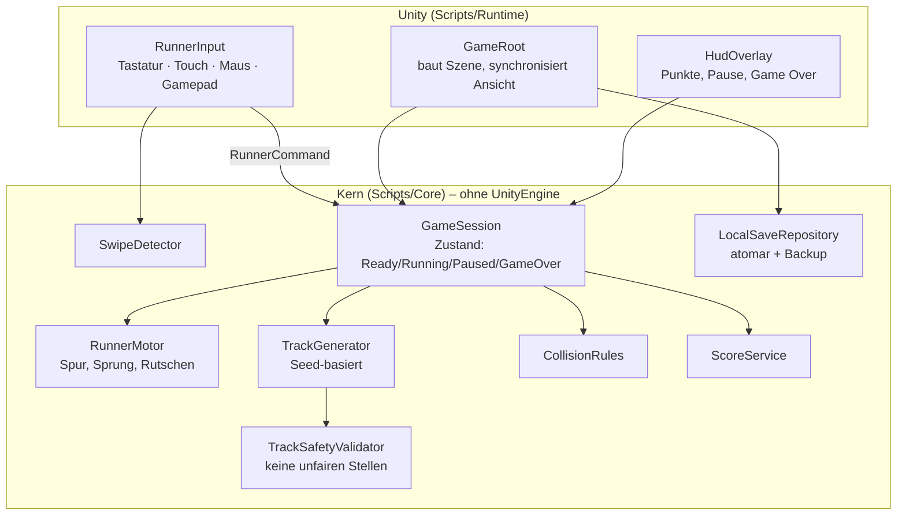

# Architektur – Fersa Surfer

## Grundidee

**Die Spielregeln kennen Unity nicht.** Der komplette Runner ist reine C#-Logik, die Unity nur anzeigt.

Das bringt drei Vorteile:
1. Die Regeln sind ohne Unity und ohne Gerät testbar. Zurzeit gibt es 55 Tests, die in unter einer Sekunde laufen.
2. Die Spiellogik ist auf jeder Plattform gleich, also deterministisch und fair.
3. Die Grafik lässt sich später austauschen (M2), ohne die Regeln anzufassen.

## Ordner

| Ordner | Inhalt | Darf Unity benutzen? |
|---|---|---|
| `Scripts/Core/Gameplay` | Konfiguration, Bewegung, Kollision, Punkte, Spielzustand | Nein |
| `Scripts/Core/Track` | Hindernistypen, Zufall, Generator, Sicherheitsprüfung | Nein |
| `Scripts/Core/Input` | Gestenerkennung | Nein |
| `Scripts/Core/Persistence` | Spielstand speichern und laden | Nein |
| `Scripts/Runtime` | Szene, Darstellung, Eingabegeräte, HUD | Ja |
| `Scripts/Editor` | Menü „Fersa Surfer“ (Szene, Materialien, Build-Einstellungen) | Ja (nur im Editor) |
| `Tests/EditMode` | Kern-Tests (auch per `dotnet test` lauffähig) | Nein |
| `Tests/PlayMode` | Rauchtest mit echtem GameObject | Ja |

## Ablauf eines Frames

1. `RunnerInput.Poll()` liefert die Befehle, zum Beispiel `MoveLeft` oder `Jump`.
2. `GameSession.Tick(dt)` teilt den Frame in Teilschritte von höchstens 20 ms. So kann die Figur bei Rucklern nicht durch eine Wand „tunneln“.
3. Pro Teilschritt passiert Folgendes:
   - Tempo erhöhen
   - Figur bewegen
   - Strecke vorausplanen
   - Kollisionen und Münzen prüfen
   - Hindernisse hinter der Figur aufräumen
4. `GameRoot.SyncViews()` stellt die 3D-Objekte an die Positionen aus der Logik.

## Regeln der Strecke

Bei Kollisionen gibt es keine Physik-Engine, sondern feste Boxen.

| Hindernis | Höhe | Lösung |
|---|---|---|
| Hürde | 0 – 1,0 m | Springen. Die Füße sind beim Sprung bis 1,6 m hoch. |
| Balken | 1,1 – 3,0 m | Rutschen. Die Figur ist dann nur 0,8 m hoch. |
| Wand | 0 – 3,5 m | Spur wechseln |

Der **TrackSafetyValidator** prüft jede neue Reihe:
- In jeder Reihe gibt es mindestens eine Spur ohne Wand.
- Zwischen zwei Reihen liegt mindestens 0,95 Sekunden Reaktionszeit, abhängig vom Tempo.
- Es gibt keine Sackgassen: Von jeder freien Spur aus ist die nächste freie Spur rechtzeitig erreichbar.

Scheitert ein Zufallsversuch zwölfmal, wird eine garantiert sichere Ersatz-Reihe eingesetzt.

## Entscheidungen
Die technischen Entscheidungen stehen in [`decisions/`](decisions/).

## Geplante Erweiterungen (Schnittstellen)

| Meilenstein | Neues Modul |
|---|---|
| M4/M5 | `Core/World`: `WorldDefinition` (JSON), `SemanticBrushInterpreter`, `WorldLayoutBuilder`, `WorldTrackValidator`. Unity-Seite: `WorldPrefabAssembler` |
| M6/M7 | `Core/Outfits`: `OutfitCatalog`, `OutfitTextParser` (DE/EN), `OutfitCompatibilityValidator`. Unity-Seite: `OutfitApplicator` |
| M11 | Eigener Server zwischen App und KI-Anbieter. Die App enthält nie API-Schlüssel (siehe `SECURITY.md`). |
