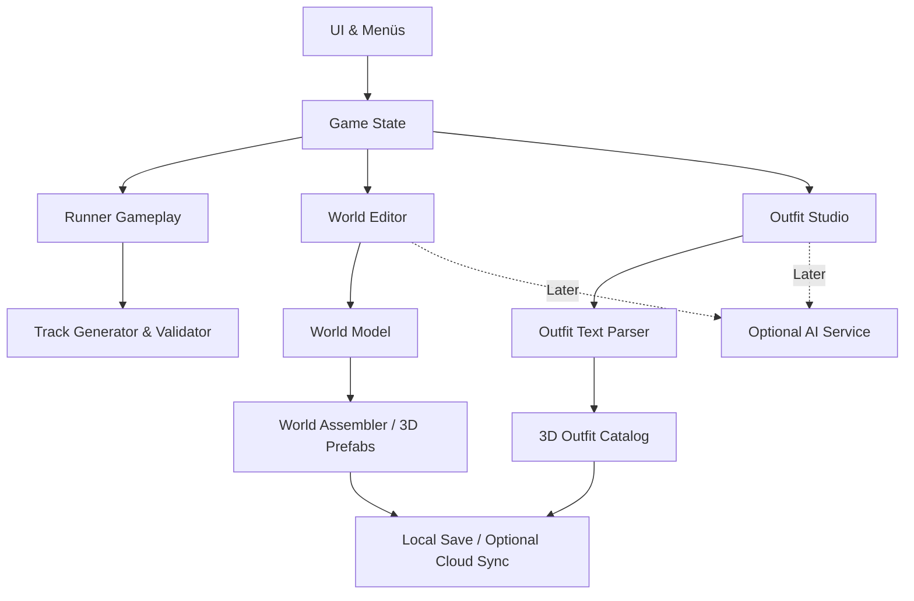

# WORLD RUSH — MASTERPLAN & ARBEITSAUFTRAG FÜR CLAUDE CODE

**Dokumenttyp:** Produktvision, Game-Design-Dokument, technische Spezifikation und ausführbarer Arbeitsauftrag  
**Version:** 1.0 · 14. November 2026  
**Arbeitstitel:** WORLD RUSH (Markenname und Domains vor Veröffentlichung prüfen)  
**Sprache der Zusammenarbeit:** Deutsch, einfach und verständlich  
**Ziel:** Ein schönes, eigenständiges, kommerziell tragfähiges 3D-Endless-Runner-Spiel, das Spieler selbst kreativ gestalten können.

> **WICHTIG FÜR CLAUDE CODE:** Lies dieses Dokument vollständig. Setze es als verbindliche Produktvision und priorisierte Entwicklungsanleitung um. Arbeite im **eigenen, neuen Repository** für WORLD RUSH; berühre niemals andere Projekte oder Repositories (insbesondere keine beruflichen Projekte). Erstelle echte Dateien, lauffähigen C#-Code, Unity-Szenen, Tests und Dokumentation. Melde ausdrücklich, was wirklich ausgeführt/getestet wurde und was mangels Unity-Umgebung nur vorbereitet ist. Beginne nach einem kurzen Repository-/Umgebungscheck mit **M0 und M1**, statt alles nur theoretisch zu beschreiben.

---

## INHALT

1. [Vision in einfachen Worten](#1-vision-in-einfachen-worten)
2. [Was dieses Spiel besonders macht](#2-was-dieses-spiel-besonders-macht)
3. [Geräte und Bedienung](#3-geräte-und-bedienung)
4. [Look & Feel: moderne 3D-Spielwelt](#4-look--feel-moderne-3d-spielwelt)
5. [Spielablauf und Mechaniken](#5-spielablauf-und-mechaniken)
6. [Welt-Designer: Zeichnung zu echter 3D-Welt](#6-welt-designer-zeichnung-zu-echter-3d-welt)
7. [Outfit-Designer mit Texteingabe](#7-outfit-designer-mit-texteingabe)
8. [Bildschirme und Benutzererlebnis](#8-bildschirme-und-benutzererlebnis)
9. [Wirtschaftsmodell und faire Monetarisierung](#9-wirtschaftsmodell-und-faire-monetarisierung)
10. [Technologie und Architektur](#10-technologie-und-architektur)
11. [Datenmodelle und Speichern](#11-datenmodelle-und-speichern)
12. [Online-Services und KI-Erweiterung](#12-online-services-und-ki-erweiterung)
13. [Qualität, Tests, Sicherheit und Datenschutz](#13-qualität-tests-sicherheit-und-datenschutz)
14. [Roadmap: Meilensteine mit Akzeptanzkriterien](#14-roadmap-meilensteine-mit-akzeptanzkriterien)
15. [Repository-Struktur](#15-repository-struktur)
16. [Arbeitsregeln für Claude Code](#16-arbeitsregeln-für-claude-code)
17. [Startauftrag an Claude Code — sofort ausführen](#17-startauftrag-an-claude-code--sofort-ausführen)
18. [Definition von „fertig“](#18-definition-von-fertig)
19. [Risiken und bewusste Entscheidungen](#19-risiken-und-bewusste-entscheidungen)
20. [Dokumentationsquellen](#20-dokumentationsquellen)

---

## 1. Vision in einfachen Worten

WORLD RUSH ist ein hochwertiges **3D-Laufspiel für Smartphone, Tablet, Computer und geeignete Webbrowser**. Die Spielfigur läuft automatisch vorwärts. Der Spieler wechselt zwischen drei Spuren, springt über Hindernisse, rutscht darunter durch, sammelt Münzen und versucht, möglichst weit zu kommen.

**Das Besondere:** Der Spieler kann **eigene Spielwelten zeichnen und automatisch in schöne 3D-Umgebungen verwandeln**. Außerdem kann er seine Spielfigur gestalten, einschließlich eines **Outfit-Wunschs als Text**, zum Beispiel:

> „Blonde Haare, rotes Kleid, braune Schuhe.“

Wenn die benötigten Kleidungsstücke im vorhandenen Katalog sind, erscheint die Kombination **unmittelbar in der 3D-Vorschau**. Für wirklich neuartige, noch nicht vorhandene 3D-Kleidung ist später eine KI-Generierung mit Wartezeit, Freigabe und Kostenkontrolle denkbar. Niemals behaupten, eine beliebige neue 3D-Figur könnte ohne Rechenzeit sofort perfekt erzeugt werden.

### Zielgruppe und Positionierung

- Zugängliches Geschicklichkeits- und Kreativspiel, einfach zu lernen, mit langfristigen Gestaltungsmöglichkeiten.
- International nutzbar; Benutzeroberfläche zunächst Deutsch und Englisch, Architektur für weitere Sprachen.
- Eigenständige Marke, Charaktere, Animationen, Welten, UI und Musik.
- **Inspiration nur auf Ebene des Genres**, keine Kopie von Subway Surfers, fremden Figuren, markanten Leveln, Grafiken, Marken oder Musik.
- Wirtschaftlich attraktiv **als Ziel, nicht als Gewinnversprechen**; die Geschäftsannahmen werden durch Tests mit echten Spielern überprüft.

### Die drei Säulen

1. **RUN:** Ein unterhaltsames, schnelles und flüssiges 3D-Runner-Spiel.
2. **CREATE:** Selbst Welten zeichnen, gestalten, verschönern, spielen und optional teilen.
3. **STYLE:** Spielfiguren mit Outfits, Haaren, Farben und Textbeschreibungen individualisieren.

---

## 2. Was dieses Spiel besonders macht

| Funktion | Ziel | Erste Version | Spätere Erweiterung |
|---|---|---|---|
| Endless Runner | Sofort spaßig | 3 Spuren, Hindernisse, Punkte | Missionen, Wettbewerbe |
| Moderne 3D-Welten | Begeisternde Grafik | Eine futuristische Stadt | Mehrere Themenwelten |
| Eigene Welt zeichnen | Kreativität | Finger-/Stiftzeichnung mit semantischen Pinseln | Interpretation freier Skizzen durch KI |
| Aus Zeichnung wird 3D | Einzigartigkeit | Vorhandene 3D-Bausteine automatisch anordnen | Generative Assets und intelligente Szenenumwandlung |
| Outfit auswählen | Eigener Stil | Fertiger 3D-Katalog | Größere Kollektionen |
| Outfit per Text | Sofortige Personalisierung | Text -> vorhandene Outfits/Varianten | Freie KI-Asset-Erstellung |
| Auf mehreren Geräten spielen | Reichweite | Android + Windows zuerst | iOS, iPadOS, macOS, Linux, Web |
| Eigene Inhalte teilen | Community | Privat speichern und laden | Moderierte Veröffentlichung und Sharing |

**Priorität:** Ein kleines, wunderschönes und spielbares Produkt ist wertvoller als ein riesiges, unfertiges Spiel.

---

## 3. Geräte und Bedienung

### Zielplattformen

**Kernplattformen:** Android-Smartphones, Android-Tablets, iPhone, iPad, Windows-PC.  
**Weitere Plattformen:** macOS, Linux sowie kompatible Desktop-Webbrowser; mobile Webbrowser nur nach Performance- und Kompatibilitätstests.  
**Konsolen:** Eine mögliche spätere Geschäftserweiterung, **kein** Versprechen für Version 1.

Die Kernlogik muss plattformunabhängig sein. Es werden separate Builds pro Plattform erstellt und geprüft; „eine Codebasis“ bedeutet **nicht**, dass eine einzige Build-Datei überall läuft.

### Eingabegeräte

- **Smartphone:** Wischen links/rechts/oben/unten; klare Touch-Schaltflächen für Menüs.
- **Tablet:** Dieselben Gesten; größere nutzbare Editor-Fläche; Finger und Stift, soweit unterstützt.
- **PC:** Pfeiltasten/WASD, Leertaste, Esc; Maus im Welt-Editor; optionale Gamepad-Belegung.
- **Barrierefreiheit:** Skalierbare UI, ausreichender Kontrast, alternative Steuereinstellungen, optional reduzierte Effekte und Haptik.
- **Responsiv:** Landscape als primärer Runner-Modus; Editor passend zu Tablet/PC; Portrait-Modus nur dann, wenn bewusst implementiert und getestet. UI-Safe-Areas beachten.

### Entwicklung vom Tablet aus

Der Auftraggeber möchte Claude Code auch **über ein iPad oder Android-Tablet** steuern können. Das bedeutet:

1. Projekt in einem **privaten GitHub-Repository**.
2. Claude Code darf im unterstützten Cloud-/Web-Workflow Code-Dateien bearbeiten.
3. Für grafische Unity-Editor-Arbeit, 3D-Vorschauen, tatsächliche Unity-Tests und Geräte-Builds ist ein geeigneter **Windows-/macOS-/Linux-Rechner** nötig (eigener Rechner, Remote-Desktop oder entsprechend eingerichteter Cloud-Rechner).
4. Eine normale Claude-Code-Cloud-Session hat nicht automatisch Unity Editor, GPU, alle Build-Module oder gültige Unity-Lizenzen. Prüfe die Umgebung zuerst.
5. Ein iOS-Geräte-Build benötigt die passende Apple-Build-Toolchain (Xcode auf macOS oder unterstützte Build-Automation) sowie Signierung/Provisioning.
6. Keine stillschweigenden Cloud-Abonnements, API-Kosten oder Käufe auslösen. Vorher Kosten und erforderliche Konten erklären.

### Build-Reihenfolge

1. **Windows-Testbuild** zum schnellen Entwickeln.
2. **Android-Testbuild** zum realen Touch-/Leistungstest.
3. **iOS-/iPadOS-Build**, wenn Apple-Toolchain verfügbar ist.
4. macOS/Linux.
5. Desktop-Web; mobiles Web nur nach Eignungsprüfung.

---

## 4. Look & Feel: moderne 3D-Spielwelt

### Nicht verhandelbares Grafikziel

Das Spiel muss **echte 3D-Geometrie** haben: Gebäude, Straße, Hindernisse, Bäume, Brücken, Figuren und Dekorationen. Keine flache 2D-Grafik, die nur wie 3D aussieht.

**Art Direction:** „Stylized premium 3D“: freundlich, futuristisch, lebendig, klar lesbar, leicht märchenhaft, mit modernen Oberflächen und hochwertiger Beleuchtung. Kein fotorealistisches Großprojekt.

### Erste Premium-Spielwelt: „Neon Garden City“

- Eigenständige futuristische Stadt mit farbigen Gebäuden, Glas, Pflanzen, Lichtern und schwebenden dekorativen Elementen.
- Gut lesbare dreispurige Laufstrecke mit nachvollziehbaren Abständen.
- Wolken, sanfte Himmelsverläufe und schöne Silhouetten in der Ferne.
- Saubere Materialien, abgestimmte Farbpalette, indirekt wirkende Beleuchtung und wenige gezielte Partikel.
- Lebendige Details wie animierte Anzeigen, Windbewegung der Bäume und gelegentliche Umgebungsanimationen.
- **Spielbarkeit geht vor Dekoration:** Hindernisse müssen klar sichtbar bleiben; kein Blendwerk, das das Spiel unfair macht.

### Stilvorgaben

- Weiche, gut lesbare Formen; klare Silhouetten.
- 3D-Figur mit überzeugendem Rig und Animationen (Idle, Run, Jump, Slide, Hit, Win/Celebrate).
- Moderne Kamera mit sanfter Nachführung, leichtem FOV-Effekt und optionalem, dezentem Kamerawackeln.
- UI: modern, aufgeräumt, großzügige Schaltflächen, schöne Mikroanimationen.
- Post-Processing nur maßvoll und mit abschaltbaren Effekten; keine Pflicht zu teuren Effekten auf schwachen Geräten.
- **Keine unlizenzierte Übernahme** fremder Modelle, Texturen, Musik, Animationen oder Schriftarten.

### Performance-Zielwerte (Ziel, keine Garantie)

- 60 FPS auf definierten geeigneten Mittelklasse-/Oberklassegeräten; 30-FPS-Fallback für schwächere Geräte.
- Objekt-Pooling, LOD, Occlusion/Frustum Culling, optimierte Materialien, begrenzte Draw Calls und Partikeleffekte.
- Grafikstufen **Low / Medium / High**; früh auf echten Geräten messen.
- Keine aufwendige KI-Inferenz im Render-Frame. KI nur im Editor-/Service-Workflow.

---

## 5. Spielablauf und Mechaniken

### Core Loop

```text
Spiel starten
  -> Figur läuft automatisch
  -> Spuren wechseln / springen / rutschen
  -> Hindernissen ausweichen und Gegenstände sammeln
  -> Punkte, Münzen und Missionsfortschritt erhalten
  -> Zusammenstoß => Game Over / Ergebnis
  -> neue Figur-Outfits oder Welten ausprobieren
  -> erneut spielen
```

### Regeln der ersten spielbaren Version

1. Drei klar definierte Spuren (links, Mitte, rechts).
2. Automatische Vorwärtsbewegung; Geschwindigkeit steigt innerhalb definierter Grenzen.
3. Spieler kann eine Spur links/rechts wechseln, springen und rutschen.
4. Mindestens drei Hindernistypen: seitlich ausweichen, überspringen, darunter durchrutschen.
5. Münzreihen, Punktezähler, Distanzanzeige, Highscore.
6. Kollisionen mit deterministischen Regeln und gut nachvollziehbarem Feedback.
7. Sichere, endlos kombinierte Track-Segmente mit bekannten Anschlussbedingungen; **keine unvermeidbaren Hindernis-Kombinationen**.
8. Pause, Game Over, Restart und Rückkehr ins Hauptmenü.
9. Anfangs Einführung/Tutorial mit drei einfachen Gesten.
10. Spiel offline nutzbar; Online-Features sind optional.

### Optionale spätere Features

- Tägliche Aufgaben, zeitlich begrenzte Herausforderungen, nicht-invasive Events.
- Sammlungen, Level-Fortschritt, freundliche kosmetische Belohnungen.
- Unterschiedliche Welten mit eigenen Hindernismustern.
- Eigene Levels mit begrenzten, validierten Streckenmodulen; im Standardmodus weiterhin Endlos-Runner.
- Keine Pay-to-Win-Monetarisierung als Kerndesign.

### Track-Generator (wichtig)

Ein gezeichneter Hintergrund darf **niemals** automatisch eine unspielbare Strecke erzeugen. Das Lauffeld ist ein gesondertes, validiertes System:

- Track läuft auf einem definierten Spline/Segmentgraphen.
- Prozedurale Segmente müssen drei nachvollziehbare Laufspuren besitzen.
- Validator überprüft Verbindungen, Kollisionsräume, Abstände und erreichbare Ausweichmöglichkeiten.
- Bei fehlerhaften Benutzervorgaben: automatisch sicheren Track einsetzen und verständliche Warnung anzeigen.
- Seed-gesteuerte Generierung ermöglicht reproduzierbare Tests.

---

## 6. Welt-Designer: Zeichnung zu echter 3D-Welt

**Das ist das stärkste Alleinstellungsmerkmal und muss sorgfältig umgesetzt werden.**

### Erlebnis aus Sicht des Spielers

1. Im Hauptmenü auf **„Meine Welt zeichnen“** tippen.
2. Eine leere Malfläche oder ein leeres 3D-Grundstück erscheint.
3. Der Spieler zeichnet mit Finger, Stift oder Maus: Straße, Bäume, Häuser, Fluss, Berge, Dekoration.
4. Er drückt **„In 3D verwandeln“**.
5. Die rohen Skizzenlinien verschwinden. An ihrer Stelle erscheinen **schöne 3D-Straßen, Gebäude, Pflanzen, Wasser und andere echte 3D-Objekte**.
6. Eine 3D-Vorschau zeigt die fertige Welt. Der Spieler kann Objekte verschieben, austauschen, färben, skalieren und löschen.
7. Er drückt **„Testen“**, läuft durch seine Welt und kann sie anschließend speichern.

### Wichtig: kein falsches „Magie“-Versprechen

Ein bloßer Filter auf einem gemalten Bild erzeugt **keine echte dreidimensionale, begehbare Welt**. Für eine zuverlässig spielbare erste Version arbeiten wir mit einem **semantischen Zeicheneditor**, der Zeichnungen in strukturierte Elemente übersetzt und dazu 3D-Prefabs verwendet.

#### V1: Semantisches Zeichnen -> 3D (ohne externe KI)

Beispiel-Pinsel:

| Pinsel | Eingabe | Umwandlung in 3D |
|---|---|---|
| Straße | Linie oder Kurve | Straßensegmente/Spline samt passender Breite |
| Baum | Punkt oder Kreis | Baum-Prefab mit Größenvariation |
| Haus | Rechteck/Fläche | Haus-Prefab mit Größe und Farbe |
| Wasser | Geschlossene Fläche | Wasser-Mesh mit geeignetem Material |
| Hügel | Fläche / Höhenregler | Sanft geformte Geländeform |
| Blumen/Garten | Markierte Zone | Mehrere Deko-Prefabs über Fläche verteilt |
| Hintergrundfarbe/Himmel | Farbauswahl | Skybox-/Atmosphäre-Einstellung |
| Hindernis | Markierte Stelle am Track | Erlaubter Hindernistyp, nach Validierung |

Dazu gehören:

- Zeichnen, Radieren, Rückgängig/Wiederholen, Verschieben, Zoomen.
- Linienvereinfachung und Kurvenglättung.
- Semantische Ebenen statt einer einzigen Pixelgrafik.
- Automatisches Positionieren geeigneter 3D-Assets.
- Kollisionserkennung zur Vermeidung störender Überlappungen.
- Einheitlicher Material-/Lichtstil („Modernize“-Schritt).
- 2D-Planansicht plus 3D-Preview, Wechsel jederzeit möglich.
- Alle Eingaben versioniert speichern (kein Datenverlust beim Umwandeln).
- Erkennbar unpassende Eingaben erklären und korrigieren lassen.
- Kein Sketch-Line-Overlay im finalen Spiel, außer Spieler aktiviert ausdrücklich einen Zeichenstil.
- Bearbeitung nach dem Generieren ohne erneute komplette Erstellung.

#### V2: Freie Skizze -> semantisches Szenenmodell (KI optional)

- Spieler malt beliebiger und beschreibt seine Vision zusätzlich als Text.
- Ein geeigneter KI-Dienst versucht, **Objektkategorien und räumliche Beziehungen** als strukturiertes JSON zu erkennen.
- Server/Client validiert das Schema und generiert eine 3D-Szene **ausschließlich aus erlaubten, sicheren Assets**.
- KI-Ausgabe ist ein **Vorschlag**; Nutzer kann ihn korrigieren.
- Fallback ohne Internet: V1-Editor bleibt funktionsfähig.
- Zeitbedarf, Kosten, Grenzen und Ablehnungen transparent darstellen.
- Optional in späterer Phase: neue, eigens lizenzierte 3D-Assets aus Generierungsdienst; Rechtslage, Qualität und Import-Validierung prüfen.

### Welt-Generator — Architektur

```mermaid
flowchart LR
    A[Finger-/Stiftzeichnung] --> B[Stroke-Erfassung]
    B --> C[Semantische Ebenen]
    C --> D[Layout-Modell]
    D --> E[Track-Validator]
    E --> F[3D-Szenenbau aus Prefabs]
    F --> G[Materialien + Licht + LOD]
    G --> H[Spielbare 3D-Vorschau]
    H --> I[Speichern und spielen]
    C -. Optional V2 .-> J[KI-Interpretation]
    J -. Validiertes JSON .-> D
```



### V1-Abnahmekriterium

Ein Spieler zeichnet **eine geschwungene Straße, drei Häuser, fünf Bäume und einen See**, tippt „In 3D verwandeln“ und erhält eine **konsistent beleuchtete, bearbeitbare und spielbare 3D-Welt**, in der keine rohen Bleistiftstriche sichtbar sind.

---

## 7. Outfit-Designer mit Texteingabe

### Bedienung

- Charakter auswählen oder anpassen.
- Kategorien: Haare, Haarfarbe, Gesicht/Style, Oberteil, Kleid/Hose, Schuhe, Accessoires.
- 3D-Vorschau mit Drehen und Zoomen.
- Eingabefeld: **„Beschreibe dein Wunsch-Outfit …“**.
- Beispiel: **„Blonde Haare, rotes Kleid, braune Schuhe.“**
- Klick auf **„Outfit erstellen“** zeigt das beste verfügbare Ergebnis.

### V1: Unmittelbare Ausgabe aus vorhandenen 3D-Assets

1. Texteingabe normalisieren; einfache deutsch-/englischsprachige Begriffe erkennen.
2. Attribute wie `hairColor=blonde`, `dressColor=red`, `shoeColor=brown` ableiten.
3. Passende Kleidungsstücke im **lokalen Katalog** suchen.
4. Falls verfügbar: vorhandene Skinned-Mesh-Outfits / vereinbarte 3D-Kleidung auf den Avatar anwenden.
5. Variationen aus zugelassenen Farben/Materialien erzeugen.
6. Ergebnis sofort lokal anzeigen, speichern und im Spiel verwenden.
7. Bei fehlendem Teil: verfügbare Alternativen anbieten; **keine falsche Aussage**, der Gegenstand sei generiert worden.
8. Sprachverarbeitung so gestalten, dass keine externe KI pro Outfit-Wechsel zwingend nötig ist.

### V2: KI für neue Looks

Wenn jemand ein Outfit wünscht, das im Katalog nicht existiert:

- Möglichkeit A: KI schlägt eine Kombination existierender Teile vor.
- Möglichkeit B: KI erzeugt ein **2D-Konzeptbild**, das erst noch in 3D umgesetzt werden muss.
- Möglichkeit C: später ein professioneller 3D-Asset-Workflow mit Rigging-/Kompatibilitätsprüfung.
- Klare Unterscheidung **„Sofort aus Katalog“** vs. **„Neue Kreation (dauert länger)“**.
- Vor kostenpflichtiger Generierung Preis/Verbrauch anzeigen und Zustimmung einholen.
- Style-/Sicherheitsfilter; keine ungeprüften oder unsicheren 3D-Modelle dynamisch ausführen/importieren.

### Technische Besonderheiten

- Ein einheitliches Character-Rig bzw. definierte Avatar-Body-Typen.
- Outfit-Pieces und Materialvarianten mit Kompatibilitätsregeln.
- Keine durch Kleidungswechsel zerstörten Animationen.
- Automatische Outfit-Validierung gegen Clipping, falsche Körperform und fehlende Materialien.
- Klare Produktdaten (SKU, Typ, Farben, Besitzstatus, Preis, Lizenz).
- Persönliche Looks offline speichern; Cloud-Abgleich optional.

### Outfit-Abnahmetest

Gib exakt ein: **„Blonde Haare, rotes Kleid, braune Schuhe.“**

Erwartung: Die 3D-Figur hat sichtbar blonde Haare, ein rotes Kleid und braune Schuhe — **sofern diese Teile verfügbar sind**. Andernfalls wird eine verständliche Alternative gezeigt. Das Outfit muss im Runner identisch aussehen wie im Designer.

---

## 8. Bildschirme und Benutzererlebnis

**UI-Design:** Professionelle Mobile-Game-Qualität; modern, intuitiv, wenig Text, klare Symbole und hochwertiges visuelles Feedback.

| Bildschirm | Inhalt | Hauptaktion |
|---|---|---|
| Start / Home | 3D-Charakter vor schöner Stadt; Buttons Spielen, Welt zeichnen, Outfits | In 1–2 Klicks ins Spiel |
| Welt auswählen | Eigene Welten, Premium-Welten, Themenwelten | Welt starten |
| Runner / HUD | Figur, Strecke, Münzen, Punktzahl, Pause | Laufen |
| Pause | Weiter, Einstellungen, Neustart, Menü | Kontrolle |
| Game Over | Distanz, Punkte, Münzen, Bestwert | Wiederholen |
| Welt-Editor 2D | Malfläche, Pinsel, Farben, Ebenen | Zeichnen |
| Welt-Editor 3D | Vorschau, drehen/zoomen, Elemente anpassen | Fertigstellen |
| Outfit-Studio | Drehbare Figur, Outfit-Katalog, Textsuche | Outfit tragen |
| Mein Profil | Gespeicherte Welten, Outfits, Einstellungen | Verwalten |
| Shop | Kosmetische Pakete und Welten mit klaren Preisen | Optional kaufen |

### Benutzerführung

- Erste Sitzung: 30–60 Sekunden grundlegende Steuerung lernen, dann direkt spielen.
- Einfache Erklärung im Welt-Editor: „Zeichne einen Weg. Setze Bäume und Häuser. Tippe auf 3D.“
- Verständliche Fehler: „Dieses Haus steht auf der Laufstrecke. Verschiebe es oder lass es automatisch anpassen.“
- Jeder Dialog hat klar erkennbaren Schließen-/Zurück-Weg.
- Editor darf bei Verbindungsabbruch nichts verlieren.
- Bei fehlendem Account lokal spielen; Konto nicht zur Voraussetzung für einfachen Spielbetrieb machen.

---

## 9. Wirtschaftsmodell und faire Monetarisierung

**Geschäftsziel:** Aus einem guten kostenlosen Spiel eine rentable, dauerhaft gepflegte Marke entwickeln. Hohe Gewinne sind **nicht garantiert**; Erfolg hängt von Spaß, Wiederkehr, organischer Reichweite, Marketingkosten und fairen Käufen ab.

### Empfohlene Erlösquellen (phasenweise)

1. **Kosmetische Outfits:** Besondere Kleidungssets, Frisuren und Effekte, ohne spielerischen Vorteil.
2. **Premium-Welten und Deko-Pakete:** Zusätzliche 3D-Themen, besondere Bau-Assets.
3. **Freiwillige Belohnungswerbung:** Nur wenn rechtlich/alterstechnisch passend, klar gekennzeichnet, ohne Zwang und ohne irreführende Mechaniken.
4. **Saisonale Inhalte:** Optionaler, transparenter Season Pass mit kosmetischen Belohnungen — erst bei ausreichender Nutzerbasis.
5. **KI-Kreationsguthaben:** Optional für rechenintensive, wirklich neue KI-Generierungen; Kosten vorher sichtbar und streng begrenzt.

### Nicht erwünscht

- Kein Pay-to-Win.
- Keine manipulativen Kaufdruck-Timer, irreführenden Angebote, Dark Patterns oder versteckten Abonnements.
- Keine Werbung, die mitten in einen Lauf hineinplatzt.
- Kein Glücksspiel-/Lootbox-System als Monetarisierungskern.
- Bei Kindern/Minderjährigen besondere Schutzmaßnahmen: keine unzulässige personalisierte Werbung, angemessene Altersfreigabe, Einwilligungen und Kaufkontrollen.

### Geschäfts-Kennzahlen, die später gemessen werden

- Erstes Spielerlebnis: Tutorial-Abschlussquote, erster Spielstart.
- Engagement: Wiederkehrraten D1, D7, D30; Sessiondauer; abgeschlossene Läufe.
- Kreativität: Anteil der Nutzer, die eine eigene Welt zeichnen; fertige 3D-Welten; verwendete Outfits.
- Monetarisierung: freiwillige Kaufquote, Umsatz pro aktiven Nutzer, Deckungsbeitrag nach Store-, KI-, Server- und Marketingkosten.
- Qualität: Crash-freie Sitzungen, durchschnittliche FPS, Ladezeit, Abstürze je Gerät.
- Datenschutzfreundliche Analytik; keine unnötige Sammlung persönlicher Daten.

### Geschäftliche Validierung

1. Erst ein hübscher, spielbarer Prototyp.
2. Mit 10–20 Testspielern Feedback einholen.
3. Prüfen, ob das kreative Welt-Feature wirklich regelmäßig verwendet wird.
4. Erst dann Shop, Nutzerkonten, Server und Marketing hochskalieren.
5. Preise und Erlösprognosen auf gemessene Daten statt Fantasiezahlen stützen.

---

## 10. Technologie und Architektur

### Technologieentscheidung

- **Engine:** Unity 6, eine gepflegte stabile Unity-6-Version im Repository fixieren.
- **Sprache:** C#.
- **Rendering:** Universal Render Pipeline (URP).
- **Input:** Unity Input System für Touch, Tastatur, Maus und Controller.
- **UI:** Unity UI Toolkit oder uGUI; eine primäre, konsistente UI-Technologie wählen und begründen. Für 3D-UI die passende Kombination.
- **Szenen/Assets:** Prefabs, ScriptableObjects, Addressables erst einsetzen, wenn es die Komplexität rechtfertigt.
- **Tests:** Unity Test Framework (EditMode und PlayMode) + manuelle Gerätetests.
- **Persistenz:** Lokale JSON-Daten mit Versionierung und sicherer Schreibstrategie; Datenbank nur bei konkretem Bedarf.
- **Source Control:** Git, privates GitHub-Repository, passende Unity-`.gitignore`, Git LFS für große Binärassets sofern gebraucht.
- **Backend:** Erst später ein minimaler, getrennt deploybarer Service für Nutzerkonten/Sync/Moderation/Generierung.
- **KI-Anbieter:** Austauschbare Schnittstelle; Anbieter/Modell nicht hart in Gameplay einbauen, Preise/Datenschutz/Qualität vor Auswahl prüfen.

### Architekturprinzipien

- Fachlogik von Unity-MonoBehaviours und Szenenobjekten so weit sinnvoll trennen.
- Ereignisgesteuerte Systeme, klare Zuständigkeiten, keine überdimensionierte Enterprise-Architektur.
- Einfache, testbare Services und Datenmodelle.
- Erzeugte Welten sind **Daten**, nicht frei ausführbarer Code.
- Ein zentraler `GameState` für Hauptmenü, Running, Paused, GameOver, Editor, DressingRoom.
- `IInputSource` abstrahiert Gesten, Tastatur und Gamepad.
- `IWorldRepository`, `IOutfitCatalog`, `IWorldAssembler`, `IOutfitInterpreter` sind austauschbare Schnittstellen.
- Eingaben und gespeicherte Inhalte strikt validieren.

### Grobe Systemübersicht



### Beispielhafte C#-Komponenten

```text
AppBootstrapper
GameStateController
RunnerController
RunnerMovementController
LaneSwitcher
JumpController
SlideController
RunnerCollisionHandler
TrackSegmentGenerator
TrackSafetyValidator
ObstacleSpawner
CoinSpawner
ScoreService
PlayerProgressService
TouchSwipeInputSource
KeyboardInputSource
GamepadInputSource
CameraFollowController
WorldCanvasController
DrawingStrokeRecorder
StrokeSimplifier
WorldLayerRepository
SemanticBrushInterpreter
WorldLayoutBuilder
WorldTrackValidator
WorldPrefabAssembler
WorldDecorationService
WorldPreviewController
WorldSaveService
AvatarController
OutfitCatalogService
OutfitTextParser
OutfitCompatibilityValidator
OutfitApplicator
OutfitPreviewController
GraphicsQualityService
LocalSaveRepository
```

Diese Namen sind Vorschläge, keine Verpflichtung zu unnötig vielen Kleinstklassen. Claude soll die einfachste wartbare Struktur wählen und begründen.

### Regeln für externe Abhängigkeiten

- Nur nötige, gepflegte Pakete mit klarer Lizenz.
- Keine kostenpflichtigen Assets oder Cloud-Services ohne Freigabe.
- Keine API-Schlüssel in Git oder in Client-Builds.
- Unity-spezifische Skripte werden nicht als „kompiliert“ bezeichnet, wenn der Unity Editor nicht ausgeführt wurde.

---

## 11. Datenmodelle und Speichern

### Beispiel: Weltdefinition (illustrativ, validierbar)

```json
{
  "schemaVersion": 1,
  "worldId": "demo-city-001",
  "name": "Meine Neon-Stadt",
  "themeId": "neon-garden-city",
  "seed": 271828,
  "sky": { "preset": "sunset", "tint": "#718CF7" },
  "objects": [
    { "id": "house-1", "kind": "building", "prefabId": "building-modern-a", "x": 12.0, "z": 32.0, "rotationY": 30.0, "scale": 1.2 },
    { "id": "tree-1", "kind": "tree", "prefabId": "tree-sakura-a", "x": -8.0, "z": 20.0, "rotationY": 0.0, "scale": 1.0 }
  ],
  "track": { "profileId": "standard-three-lanes", "pathId": "safe-demo-spline" },
  "sourceDrawingId": "drawing-demo-001"
}
```

### Beispiel: Outfit-Wunsch als geparste Daten

```json
{
  "hair": { "styleId": "medium-straight", "color": "blonde" },
  "clothing": { "type": "dress", "color": "red" },
  "footwear": { "type": "shoes", "color": "brown" }
}
```

### Speichervorgaben

- Versionierte Dateiformate mit Migrationsmöglichkeit.
- Lokale Autosaves im Editor, Undo-Historie und Backups für kritische Nutzerentwürfe.
- Speichern atomar, damit App-Absturz nicht beide Weltkopien zerstört.
- Eindeutige IDs, maximale Anzahl Objekte/Striche/Dateigrößen.
- Sicherer Umgang mit ungültigen, manipulierten oder unvollständigen Dateien.
- Keine persönlichen Daten in öffentliche Weltdateien schreiben.
- Cloud-Sync später mit Konfliktregel und ausdrücklich sichtbarem Status.

---

## 12. Online-Services und KI-Erweiterung

### V1: So viel wie möglich offline

- Spielen, fertige Standardwelten, eigener Welt-Editor, einfacher Outfit-Textparser und lokale Speicherung funktionieren ohne Internet.
- Kein dauerhaftes Backend notwendig, um die erste spielbare Demo auszuführen.

### V2: Optionale Cloud-Funktionen

- Konto / Cloud-Save.
- Freiwilliges Teilen und Entdecken von Community-Welten.
- KI-Interpretation freier Zeichnungen.
- Möglicherweise neue Outfit-Konzepte oder neue 3D-Assets nach professioneller Prüfung.
- Moderation, Meldesystem, Sperr- und Löschfunktionen für Community-Inhalte.

### Sichere KI-Architektur

```text
Client (Unity) -> Authentifizierter eigener API-Dienst
  -> Rate Limit / Kostenlimit / Moderation
  -> KI-Anbieter (nach Auswahl)
  -> strukturierte Antwort + Schema-Prüfung
  -> sichere 3D-Baustein-Assemblierung im Client
```

- Keine fremden API-Schlüssel direkt in die ausgelieferte App.
- Keine ungeprüften DLLs, Skripte oder ausführbaren Inhalte aus der KI laden.
- Prompts, Antworten und Nutzerdaten datenschutzgerecht behandeln; möglichst wenig speichern.
- Missbrauch, Spam, Massen-Generierungen und Kostenexplosion verhindern.
- Der Nutzer muss jederzeit wissen, ob ein Outfit aus lokalen Katalogteilen oder aus einer neuen KI-Erstellung stammt.
- Wenn ein Dienst ausfällt: Runner und lokale Funktionen bleiben nutzbar.

---

## 13. Qualität, Tests, Sicherheit und Datenschutz

### Automatisierte Tests

**EditMode / Unit-Tests:**

- Spurwechsel links/Mitte/rechts und Grenzen.
- Bewegungs-/Zustandsregeln; Pause/Game Over.
- Punktesystem und Sammelobjekte.
- Track-Segmentverbindungen, Hindernis-Sicherheitsvalidator, reproduzierbare Seeds.
- Pinselinterpretation, Stroke-Simplification und Welt-Layout-Grenzen.
- JSON-Schema- und Datenversionsprüfung, Save/Load-Roundtrip.
- Outfit-Textparser für deutsche und englische Standardformulierungen.
- Outfit-Kompatibilität, Fallbacks und fehlende Assets.
- KI-Schema-Validierung mit simulierten Antworten (kein echter kostenpflichtiger Dienst nötig).

**PlayMode / Integration:**

- Menü -> Spielen -> Pause -> Game Over -> Neustart.
- Welt zeichnen -> Umwandeln -> Preview -> Speichern -> erneut laden -> spielen.
- Outfit-Eingabe -> 3D-Vorschau -> Runner zeigt dasselbe Outfit.
- Touch-/Tastatur-Input und Gerätegrößen soweit testbar.
- 10+ Minuten Runner ohne Segment-Leaks und unkontrollierten Speicheranstieg (Profiling separat nachweisen).

### Manuelle Tests auf realen Geräten

- Mindestens ein schwächeres Android-Gerät, ein leistungsfähigeres Android-Gerät, ein Tablet und nach Verfügbarkeit ein iPhone/iPad.
- Unterschiedliche Bildschirmauflösungen und Safe Areas.
- Performance, Hitze, Akku, Eingabe-Latenz, App-Pause/Fortsetzen.
- Offline-Modus, beschädigte Speicherdateien, Wiederherstellung.
- Tests für Tastatur/Maus/Gamepad auf PC.
- Web-Browser nur dort als unterstützt bezeichnen, wo getestet.

### Sicherheits- und Rechts-Checkliste

- Eigene bzw. korrekt lizenzierte Figuren, 3D-Assets, Musik, Texte und Fonts.
- Marke/Name/Store-Auftritt vor Veröffentlichung recherchieren.
- Datenschutz nach einschlägigen Vorgaben (u. a. DSGVO), Datensparsamkeit, Löschbarkeit.
- Bei Kindern/Teenagern: Altersfreigabe, gesetzliche Einwilligungen und passende Regeln für Werbung, soziale Inhalte und Käufe.
- Für UGC: Moderation, Melden, Missbrauchsprävention und Urheberrechtsverfahren vor öffentlicher Freigabe.
- Store-Richtlinien und in-App-Kauf-Regeln jeweils aktuell prüfen.
- Keine Behauptung, die App sei rechtssicher oder zertifiziert, solange keine Prüfung erfolgt ist.

### Leistungsprüfung

- Pro Zielgerät FPS, Frame-Time, RAM, Ladezeit, Build-Größe messen.
- Performance-Budgets nach ersten echten Messungen definieren.
- Screenshots/Gameplay-Clips der realen Unity-Szenen bereitstellen, nicht nur KI-Konzeptbilder.

---

## 14. Roadmap: Meilensteine mit Akzeptanzkriterien

**Regel:** Jeder Meilenstein liefert ein greifbares, testbares Ergebnis. Kein monatelanges Architekturtheater. Nicht alles gleichzeitig bauen.

| Milestone | Inhalt | Fertig, wenn ... |
|---|---|---|
| **M0 — Setup** | Repo, Unity-6-Projekt, URP, Input System, Git, README, Tests, Qualitätsregeln | Projektstruktur, Szenen und Setup-Doku existieren; tatsächliche Editor-Verfügbarkeit dokumentiert |
| **M1 — Spielbarer Kern** | 3 Spuren, automatisch laufen, springen, rutschen, Hindernisse, Münzen | Spieler kann im echten Unity-PlayMode laufen oder fehlender Editor ist klar ausgewiesen |
| **M2 — Premium-3D-Stadt** | Eigenständiger Neon-Garden-City-Stil, Materialien, Kamera, Animationen | Klar erkennbare schöne 3D-Szene, Performance-Baseline |
| **M3 — Menüs & Fortschritt** | Home, Pause, Game Over, Score, Settings, lokale Highscores | Vollständiger Offline-Gameplay-Loop |
| **M4 — Welt-Editor 2D** | Zeichnen, Pinsel, Undo/Redo, Objekte, Speichern | Spieler erstellt einen editierbaren Welt-Plan |
| **M5 — Zeichnung -> 3D** | Semantische Zuordnung, Prefabs, Spline, sichere 3D-Welt, Preview | Haus/Baum/Straße/Wasser aus Zeichnung erscheinen als echte 3D-Objekte |
| **M6 — Outfit-Studio** | Avatar, Katalog, Haare, Kleidung, Farben, 3D-Preview | Outfits lassen sich wählen und im Lauf tragen |
| **M7 — Text-Outfits** | Deutsch/Englisch-Parser, Katalog-Matching, Fallbacks | Beispiel mit blond/rot/braun funktioniert aus vorhandenen Teilen |
| **M8 — Mobile Qualität** | Android/Tablet-Optimierung, Touch, UI, echte Testbuilds | Android auf Referenzgeräten stabil und spielbar; iOS-Pipeline vorbereitet |
| **M9 — Weitere Plattformen** | iOS/iPadOS, macOS/Linux, ggf. Desktop-Web | Plattformen einzeln gebaut und auf tatsächlichen Geräten/Browsern geprüft |
| **M10 — Kommerz-Basis** | Optionaler kosmetischer Shop, Analytics, rechtlicher Check | Shop-Regeln klar, keine Käufe in Prototyp versehentlich ausgelöst |
| **M11 — KI & Community (optional)** | Freie Skizzeninterpretation, neue Outfit-Ideen, Sync/Sharing | Kosten, Moderation, Sicherheit und Qualität nachweisbar beherrscht |

### Priorität bei knappem Budget oder API-Limit

1. M0 und M1 zuerst (spielbar).
2. M2 und M3 für ein Produkt, das optisch überzeugt.
3. M4–M7 für die einzigartigen Kreativfunktionen.
4. M8/M9 für echte Geräte-Reichweite.
5. M10/M11 erst, wenn der Kern tatsächlich Spaß macht.

### Für jeden Meilenstein liefern

- Geänderte Dateien und wofür sie da sind.
- Kurze deutsche Erklärung **ohne Fachchinesisch**.
- Eine konkrete Demo-/Testanleitung: Was klickt der Auftraggeber an?
- Liste der erfolgreich ausgeführten Tests samt Kommandos/Ergebnissen.
- Eine separate Liste **„Nicht getestet / externe Voraussetzungen“**.
- Offene Fehler, Risiken, nächste Schritte.
- Wenn möglich einen sinnvollen Commit und eine nachvollziehbare Statusdatei.

---

## 15. Repository-Struktur

Vorschlag; bei Bedarf an Unity-Konventionen anpassen:

```text
WorldRush/
├── README.md
├── CLAUDE.md
├── .gitignore
├── .gitattributes
├── Assets/
│   ├── _WorldRush/
│   │   ├── Art/
│   │   │   ├── Characters/
│   │   │   ├── Environments/
│   │   │   ├── Outfits/
│   │   │   └── Materials/
│   │   ├── Audio/
│   │   ├── Prefabs/
│   │   │   ├── Runner/
│   │   │   ├── Track/
│   │   │   ├── WorldObjects/
│   │   │   └── Avatars/
│   │   ├── Scenes/
│   │   │   ├── Bootstrap.unity
│   │   │   ├── MainMenu.unity
│   │   │   ├── RunnerDemo.unity
│   │   │   ├── WorldEditor.unity
│   │   │   └── OutfitStudio.unity
│   │   ├── Scripts/
│   │   │   ├── Core/
│   │   │   ├── Gameplay/
│   │   │   ├── Input/
│   │   │   ├── WorldEditor/
│   │   │   ├── WorldGeneration/
│   │   │   ├── Characters/
│   │   │   ├── Outfits/
│   │   │   ├── UI/
│   │   │   └── Persistence/
│   │   ├── ScriptableObjects/
│   │   ├── UI/
│   │   └── Tests/
│   │       ├── EditMode/
│   │       └── PlayMode/
├── Packages/
├── ProjectSettings/
├── docs/
│   ├── PRODUCT_VISION.md
│   ├── GAME_DESIGN.md
│   ├── ARCHITECTURE.md
│   ├── WORLD_EDITOR.md
│   ├── OUTFIT_SYSTEM.md
│   ├── CROSS_PLATFORM.md
│   ├── ART_DIRECTION.md
│   ├── MONETIZATION.md
│   ├── TEST_PLAN.md
│   ├── PROJECT_STATE.md
│   ├── OPEN_ISSUES.md
│   └── decisions/
│       └── ADR-001-unity-urP.md
└── tools/
```

**Repository-Hygiene:** `Library/`, `Temp/`, `Obj/`, `Build/`, Logs und Secrets nicht committen. `.meta`-Dateien aus `Assets` und `Packages/manifest.json` mitversionieren. Übermäßige Asset-Größen vermeiden; erforderlichenfalls Git LFS einrichten. Tatsächliche Unity-Projektdateien müssen valide sein — keine willkürlich erdachten `.unity`-/`.prefab`-YAML-Dateien ohne Unity-Validierung als fertig ausgeben.

---

## 16. Arbeitsregeln für Claude Code

### Claude soll selbstständig handeln, aber ehrlich bleiben

1. **Nicht nur beraten:** Nach einer kurzen Prüfung direkt Dateien, Code, Tests und Setup erstellen.
2. **Klein anfangen:** Erst einen spielbaren Runner mit primitiven 3D-Objekten; dann Grafik veredeln; dann Editor und Outfits.
3. **Schrittweise implementieren:** Keine halbfertigen 100 Dateien ohne lauffähige Zwischenstände.
4. **Code zuerst testbar:** Kernregeln mit EditMode-Tests und klaren Abhängigkeiten.
5. **Keine falschen Erfolgsmeldungen:** Ohne Unity Editor keine „erfolgreich kompiliert“-Behauptung. Ohne Gerät kein „Android/iOS getestet“.
6. **Keine kostenpflichtigen Dienste ohne Freigabe.** Keine API-Keys im Repository.
7. **Nur eigenes Projekt:** Keine Dateien anderer Repositories öffnen/ändern, wenn das nicht nötig ist.
8. **Versionen fixieren:** Unity-Version, Packages und getroffene technische Entscheidungen dokumentieren.
9. **Arbeitsstand fortschreiben:** `docs/PROJECT_STATE.md` und `docs/OPEN_ISSUES.md` nach jedem Meilenstein aktualisieren.
10. **Deutsch antworten:** Kurz und einfach, mit Beispielen: „Das macht die Figur“, „Das macht der Welt-Editor“.
11. **Keine unnötige KI-Abhängigkeit:** Spiellogik und erstes Welt-/Outfit-System funktionieren offline.
12. **Wenn das Limit knapp wird:** Einen sauberen, reproduzierbaren Zwischenstand samt Status und Next Steps hinterlassen.

### Modellwahl innerhalb Claude Code

- **Aktuell verfügbares Opus-Modell** für schwierige Architektur, Welt-Generator, Fehleranalyse und wichtige Reviews.
- **Aktuell verfügbares Sonnet-Modell** für normale Implementierung, Refactoring, Tests und UI-Aufgaben, sofern technisch ausreichend.
- Keine veralteten oder nicht nachweisbar angebotenen Modellversionsnamen voraussetzen. Modellwahl ist **kein** Garant für hochwertige 3D-Assets; Engine, Asset-Workflow, Tests und Design sind entscheidend.

### Statusbericht nach jedem Arbeitsblock

```text
WORLD RUSH — STATUS
Stand: [Meilenstein]
Fertig umgesetzt:
- ...
Geänderte Dateien:
- ...
Tatsächlich ausgeführt/getestet:
- ...
Nicht ausgeführt / Grund:
- ...
So kann ich es selbst ausprobieren:
1. ...
Offene Fehler oder Kosten:
- ...
Nächster konkreter Schritt:
- ...
```

---

## 17. Startauftrag an Claude Code — sofort ausführen

> **DIESEN ABSCHNITT ALS DIREKTEN ARBEITSAUFTRAG VERSTEHEN:**
>
> Du bist Lead Unity Developer, Senior C# Engineer, Technical Artist, UI/UX Designer, Mobile Performance Engineer und pragmatischer Indie-Game-Produzent für WORLD RUSH. Baue ein **wirklich spielbares 3D-Spiel** statt nur einen Konzepttext. Die große Produktvision steht in diesem Dokument. Vermeide unnötige Rückfragen und treffe sinnvolle Standardentscheidungen selbst, sofern keine rechtlichen oder kostenpflichtigen Freigaben erforderlich sind.
>
> **Jetzt sofort:**
>
> 1. Prüfe `pwd`, Repository, vorhandene Dateien, Git-Status und verfügbares Unity-/C#-Build-Tooling; dokumentiere die Ergebnisse.
> 2. Sorge dafür, dass ausschließlich ein neues, isoliertes WORLD-RUSH-Projekt bearbeitet wird.
> 3. Erstelle `README.md`, `CLAUDE.md`, `docs/PROJECT_STATE.md`, `docs/OPEN_ISSUES.md`, `docs/ARCHITECTURE.md`, passende `.gitignore` und Setup-Anleitung.
> 4. Erstelle oder initialisiere — soweit die Umgebung dies seriös erlaubt — ein Unity-6-URP-Projekt und dokumentiere die exakte Unity-/Package-Version.
> 5. Implementiere **M1**, den minimal spielbaren 3D-Endless-Runner: 3 Spuren, automatisch vorwärts, Springen, Rutschen, Input-Abstraktion, Hindernisse, Münzen, Score, Game Over und Neustart.
> 6. Implementiere zugehörige Unit-/PlayMode-Tests. Wenn Unity nicht vorhanden ist, generiere sauberen Unity-kompatiblen Code und echte Testdateien; markiere Unity-Szenen-/Kompilierungsvalidierung als offen.
> 7. Verwende zunächst eigene einfache 3D-Geometrie und Materialien als **Prototyp**, um nicht durch fehlende Premium-Assets blockiert zu werden.
> 8. Erstelle eine klare Bedienungsanleitung für Windows und Android. Für iOS/Tablet/Cloud erkläre die noch nötigen Voraussetzungen.
> 9. Erzeuge einen nachvollziehbaren Zwischenstand und gib einen kurzen Statusbericht auf Deutsch aus.
>
> **Danach**: M2 (optisch schöne futuristische 3D-Stadt), M3 (Menüs), anschließend Welt- und Outfit-Editor, streng nach Roadmap.
>
> **Wichtig:** Ich will später auf iPhone, Android, Tablets, Windows, Mac und Linux spielen können. Der Welt-Editor soll freie gezeichnete Linien in schön gestaltete **echte 3D-Objekte** umwandeln; das geschieht zunächst über semantische Pinsel und 3D-Prefabs, nicht durch bloße Bildfilter. Der Outfit-Designer soll eingegebene Wünsche möglichst direkt aus einem vorhandenen kompatiblen 3D-Katalog umsetzen.
>
> **Berichte immer wahrheitsgemäß.** Nenne eine Version nur „spielbar“, wenn sie wirklich in einem geeigneten Unity-Editor oder auf einem Gerät gestartet und geprüft wurde. Falls das technisch nicht möglich ist: Bezeichne sie als „vorbereiteter Unity-Projektstand“, nenne genau, was noch getan werden muss, und fahre mit den unabhängig machbaren Schritten fort.

---

## 18. Definition von „fertig“

### Fertig für die erste spielbare Demo

- [ ] Szene mit echter 3D-Umgebung.
- [ ] Steuerbare 3D-Spielfigur, die automatisch läuft.
- [ ] Spurwechsel, Springen, Rutschen.
- [ ] Hindernisse und Münzen.
- [ ] Punkte, Game Over, Neustart.
- [ ] Grundlegendes Menü und Spielpause.
- [ ] Mindestens ein echter PlayMode-/Gerätetest dokumentiert.
- [ ] Klare Hinweise, wie der Auftraggeber die Demo startet.

### Fertig für den Kreativ-Prototyp

- [ ] Finger-/Stiftzeichnung mit Undo/Redo.
- [ ] Semantische Pinsel und gespeicherter Weltplan.
- [ ] Zeichnung wird zur echten 3D-Szene ohne sichtbare Rohlinien.
- [ ] Track bleibt spielbar und ist validiert.
- [ ] Selbst erstellte Welt kann gespeichert, geladen und bespielt werden.
- [ ] Figur kann sichtbare Outfits wechseln.
- [ ] Texteingabe „Blonde Haare, rotes Kleid, braune Schuhe“ führt zu vorhandenen passenden 3D-Teilen.
- [ ] Leistungs- und Nutzerführungstest auf mindestens einem echten Mobilgerät.

### Noch NICHT automatisch „fertig“

- [ ] Store-Veröffentlichung und Altersfreigaben.
- [ ] Neue generative 3D-Assets aus beliebigen Texteingaben in Echtzeit.
- [ ] Komplettes Moderations- und Community-System.
- [ ] iOS-Signierung und App-Store-Review.
- [ ] Nachgewiesene Profitabilität.

---

## 19. Risiken und bewusste Entscheidungen

| Risiko | Gegenmaßnahme |
|---|---|
| Freie Zeichnung lässt sich nicht zuverlässig in spielbare 3D-Welt übersetzen | Erst semantischer Editor + validierte 3D-Prefabs, KI später |
| Ungewöhnliches Outfit hat kein passendes Modell | Sofortvorschau aus Katalog; Alternativen zeigen; neue Kreation später |
| Tablet kann Unity nicht nativ öffnen | Claude Code in Cloud + separater Unity-Rechner / Remote-Desktop |
| Schöne Grafik läuft auf schwachen Handys langsam | URP-Qualitätsstufen, Profiling, optimierte Assets |
| KI-/Cloud-Kosten werden zu hoch | Offline-first, Caching, Limits, explizite Freigaben |
| Zu großes Projekt, nie fertig | Meilensteine, erst spielbarer Prototyp, regelmäßige Tests |
| Ähnlichkeit zu fremdem Spiel führt zu IP-Problemen | Eigenständiger Stil, Marke, Assets und UX |
| UGC verstößt gegen Rechte/Schutzvorgaben | Zunächst privat; Moderation und rechtliche Prozesse vor öffentlichem Sharing |
| Nutzer geben Geld aus, aber spielen nicht lange | Frühe Nutzertests, Retention-Daten, faire Monetarisierung |
| Code-Dateien sind nicht mit Unity geprüft | Strikte Trennung zwischen geschrieben, kompiliert und wirklich getestet |

### Unverhandelbare Produkteigenschaften

- **Echte moderne 3D-Grafik**.
- **Einfach spielbar** und wunderschön gestaltet.
- **Eigene Welten zeichnen und in 3D umwandeln**.
- **Outfits manuell und über Text beschreiben**.
- **Cross-Platform-Architektur**.
- **Faire Monetarisierung** und vernünftige Betriebskosten.
- **Saubere, getestete Zwischenergebnisse**.

---

## 20. Dokumentationsquellen

Diese offiziellen Anlaufstellen bei der Implementierung aktuell prüfen; Versionsstände können sich ändern:

- Unity 6 Systemanforderungen / unterstützte Plattformen: https://docs.unity3d.com/6000.0/Documentation/Manual/system-requirements.html
- Unity 6 Input System: https://docs.unity3d.com/6000.0/Documentation/Manual/com.unity.inputsystem.html
- Unity 6 iOS-Umgebung (Xcode/Build-Automation): https://docs.unity3d.com/6000.0/Documentation/Manual/ios-environment-setup.html
- Unity Manual: https://docs.unity3d.com/
- Claude Code: https://code.claude.com/docs/
- Unity Personal/Lizenzen: https://unity.com/products/unity-personal (Bedingungen vor kommerzieller Veröffentlichung prüfen)

---

## ABSCHLIESSENDER AUFTRAG

**Claude Code: Implementiere jetzt M0 + M1 in einem sauberen, isolierten Unity-Projekt, dokumentiere jeden tatsächlich verifizierten Schritt und zeige den nächsten spielbaren Zwischenstand.** Arbeite anschließend systematisch an den modernen 3D-Grafiken und erst danach an den Kreativfunktionen. **Keine bloße Ideensammlung als Endergebnis.**
